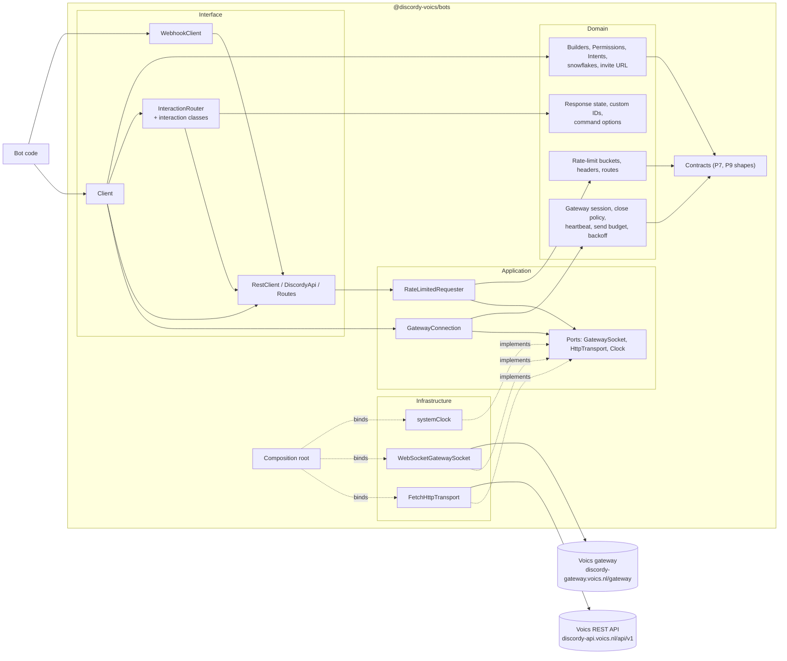

# Architecture

`@discordy-voics/bots` is a lean TypeScript SDK for Voics bots. It speaks the P7 gateway protocol and the P9 REST API, and it is organised in four layers plus a composition root.

## Layers

| Layer | Folder | Responsibility | May import |
|---|---|---|---|
| Domain | `src/domain/` | Pure rules: permission and intent bitfields, snowflakes, gateway session and close-code policy, heartbeat tracking, send budget, rate-limit buckets and headers, interaction response state, builders with Discord's limits, invite URLs | `contracts` only |
| Application | `src/application/` | Use cases and their ports: `GatewayConnection` (identify, heartbeat, resume, reconnect), `RateLimitedRequester` (per-bucket queues), `TypedEmitter`, and the ports `Clock`, `GatewaySocket`, `HttpTransport` | domain, contracts |
| Infrastructure | `src/infrastructure/` | Adapters for the ports: `FetchHttpTransport` (global `fetch`), `WebSocketGatewaySocket` (WHATWG `WebSocket`), `systemClock` | application ports, domain |
| Interface | `src/interface/` | Public classes: `Client`, `RestClient`, `DiscordyApi`, `Routes`, `InteractionRouter` and the interaction classes, `WebhookClient` | everything above |

`src/contracts/` mirrors the pinned P7 (gateway) and P9 (REST) wire shapes. It is the one module to swap for the generated `@discordy-voics/contracts` package once it is published.

`src/composition-root.ts` is the only place that binds ports to adapters. Public classes call its factories (`defaultTransport`, `defaultClock`, `defaultRandom`, `defaultSocketFactory`) for any dependency the caller did not inject, which keeps the unit tests free of real sockets and network calls.

## Component diagram

## Key flows

**Gateway session.** `Client.login()` opens a `GatewayConnection` through the socket factory. The connection identifies with the bot token and the intents resolved by `Intents.resolve`. Heartbeats run at the HELLO interval, and a missed acknowledgement counts as a zombie connection. Close codes are classified by `classifyClose`: resumable codes reconnect and send RESUME within the 120-second window, re-identifiable codes identify again, and fatal codes (4004, 4013, 4014) reject `login()` and emit `error`. Reconnects back off exponentially with jitter, and `SendBudget` keeps outgoing frames under 120 per 60 seconds.

**REST request.** `DiscordyApi` and `RestClient` build a route key from the method and path. `RateLimitedRequester` queues the request in the bucket named by `X-RateLimit-Bucket` (scoped by the major parameter: channel, guild or webhook). When a bucket is empty, the requester waits for `X-RateLimit-Reset-After`. A 429 (bucket or global) or a transient 5xx is retried up to `retries` times; anything else becomes a `DiscordyApiError`.

**Interaction.** `INTERACTION_CREATE` is dispatched to `InteractionRouter`, which matches slash commands by name (with subcommand and group paths), components and modals by custom-ID pattern, and autocomplete by command name. Each interaction class holds an `InteractionResponseState`, so a second initial response throws `InteractionStateError` before any request is sent.

## Design decisions

- **Ports and adapters.** Gateway and HTTP transports sit behind ports, so the reconnect and rate-limit logic is unit-tested with a fake gateway and mocked REST, and no real network is needed.
- **No environment variables in the SDK.** Configuration is passed to `new Client({...})` and validated there. Environment handling belongs to the bot (see `examples/moderation-bot`).
- **Bots see Standard channels only.** Ephemeral and P2P delivery modes never reach bots (P11), so the SDK exposes no API for them.
- **Single runtime dependency surface.** The SDK uses the platform `fetch` and `WebSocket` (Node 22+). It ships ESM and CommonJS builds from `tsup` with no runtime dependencies.
- **Public API is curated.** `src/index.ts` is the only entry point. TypeDoc generates `docs/api` from it, and CI fails when that folder is stale.

## Testing

| Layer | Test approach |
|---|---|
| Domain | Pure unit tests (`test/domain`) |
| Application | Fake gateway socket and fake clock (`test/application`, `test/support/fake-gateway.ts`) |
| Interface | Mocked `HttpTransport` and fake gateway (`test/interface`) |
| Contracts | Golden tests against the pinned shapes (`test/contracts`) |
| Example bot | Command handlers with fake clients (`examples/moderation-bot/test`) |
